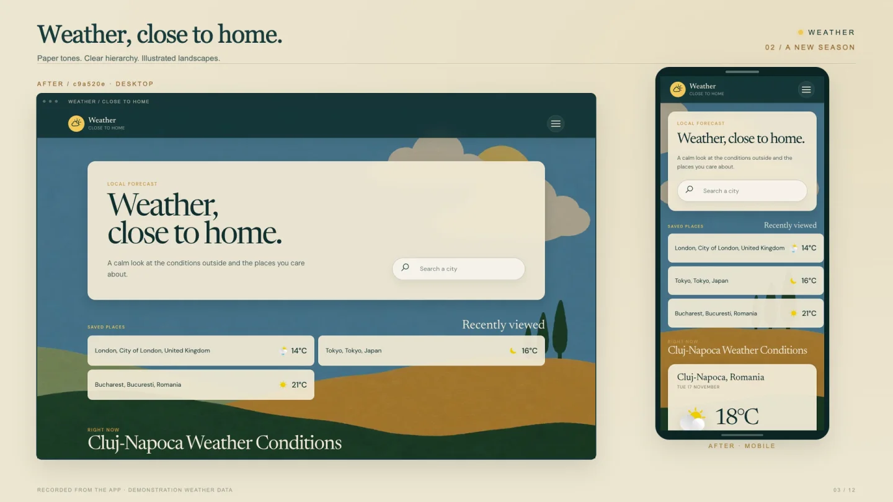
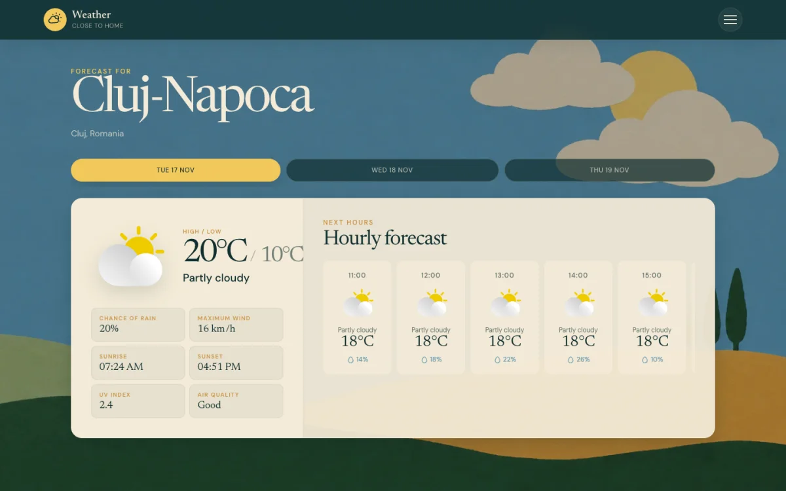
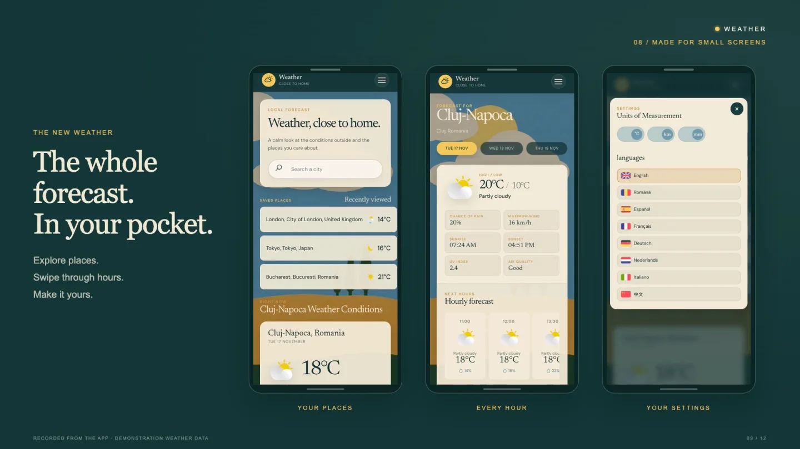

# Weather, close to home.

A weather app with illustrated landscapes, a calm paper-inspired interface, and a forecast that keeps the useful details together. Built with React, TypeScript, and Sass.

[**Open the app ↗**](https://enhanced-weather-app.netlify.app/) · [**Watch the trailer ↗**](https://enhanced-weather-app.netlify.app/showcase/) · [Getting started](#getting-started)

[](https://github.com/RaduStefan30/weather-app-enhanced/actions/workflows/build.yml)
[](https://sonarcloud.io/summary/new_code?id=RaduStefan30_weather-app-enhanced)
[](LICENSE)

## A fresh outlook

[](https://enhanced-weather-app.netlify.app/showcase/)

**1 minute 38 seconds · 1080p · 60 fps · original music**

The original app and its redesign, shown on desktop and mobile: smooth scrolling, city search, hourly forecasts, settings, alerts, and the complete weather artwork collection. Recorded from the actual app with consistent demonstration weather data.

[Watch with sound](https://enhanced-weather-app.netlify.app/showcase/) · [Download the MP4](https://enhanced-weather-app.netlify.app/showcase/weather-trailer.mp4)

## What you can do

- **Check the weather close to home.** Start with an approximate location from your IP, or search for a city with autocomplete. Revisit recent searches and explore six cities around the globe.
- **Plan the next three days.** See the daily overview beside the hourly forecast, including high and low temperatures, rain probability, maximum wind, sunrise, sunset, and UV. Today's overview also includes current air quality when available.
- **Read the current conditions.** Temperature, feels like, wind, rainfall, humidity, and pressure are grouped in a compact dashboard.
- **Keep an eye on advisories.** A weather alert appears when the provider returns one for the selected location.
- **Make it yours.** Switch temperature, distance, and rainfall units. Choose English, Romanian, Spanish, French, German, Dutch, Italian, or Chinese. Preferences and recent searches stay in local storage.
- **Follow the changing scenery.** Eleven illustrated weather states, day and night treatments, and forecast background preloading. The layout adapts from desktop to phone.

## A closer look

### Daily context, hourly detail



### The same app, on a smaller screen



Screenshots use demonstration data. Explore the landscapes independently in the [artwork preview](https://enhanced-weather-app.netlify.app/background-preview).

## Getting started

You'll need Node.js and npm, plus a [WeatherAPI.com](https://www.weatherapi.com/) API key. Local development is verified with Node.js 22.

```bash
git clone https://github.com/RaduStefan30/weather-app-enhanced.git
cd weather-app-enhanced
npm ci
cp .env.example .env
```

Add your key to `.env`:

```dotenv
VITE_SECRET_KEY=your_weatherapi_key_here
```

Then start the app:

```bash
npm run dev
```

Open the local URL printed by Vite, usually `http://localhost:5173`. Restart the server after changing `.env`.

Vite loads `.env` through its built-in dotenv support. Local environment files are ignored by Git; `.env.example` is the committed template. `VITE_` variables are included in the browser bundle, so this API key is visible to app users. For a deployment that needs to keep provider credentials private, move the API calls behind a server-side proxy.

## Development

| Command | Purpose |
| --- | --- |
| `npm run dev` | Start the Vite development server |
| `npm run build` | Type-check and build into `dist/` |
| `npm run preview` | Serve the production build locally |
| `npm run lint` | Run ESLint with zero warnings allowed |
| `npm test -- --runInBand` | Run Jest and React Testing Library tests |
| `npm test -- --coverage` | Generate test coverage for review |

The app uses React Context with a reducer for weather and unit state, React Router for navigation, i18next for translation, Axios for API requests, and Sass for styling. GitHub Actions runs tests and coverage; SonarCloud checks code quality. Netlify provides production hosting and PR deploy previews.

```text
src/
├── api/          WeatherAPI and IP lookup requests
├── components/   Weather cards, settings, search, alerts, and backgrounds
├── contexts/     Weather state and reducer
├── locales/      Eight interface translations
├── pages/        Dashboard, forecast details, and artwork preview
├── styles/       Shared styles and design tokens
└── utils/        Weather mappings, preloading, and formatting
public/
├── backgrounds/  Illustrated weather artwork
└── showcase/     Trailer player, poster, and video
```

## Deployment and data

Run `npm run build` and publish `dist/`. Set `VITE_SECRET_KEY` in the hosting environment **before building**. The included Netlify redirect in `public/_redirects` supports direct links to application routes.

Weather forecasts and advisories come from [WeatherAPI.com](https://www.weatherapi.com/); approximate location lookup uses [ipify](https://www.ipify.org/). Data availability depends on the provider and API plan. Weather condition text follows the selected app language, but official alerts may retain the issuing authority's language.

The app runs in the browser and has no account system. Recent searches and preferences are stored on the device; location searches are sent to the weather provider.

## Credits and license

Created by [Ranzascu Radu](https://github.com/RaduStefan30). The trailer uses the app's artwork and an original synthesized instrumental score. [Media and recording details](docs/media/README.md).

Available under the [MIT License](LICENSE).
